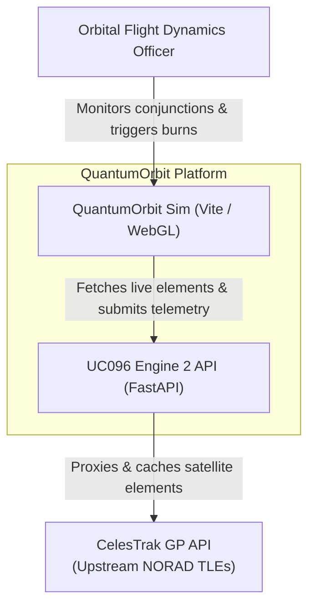
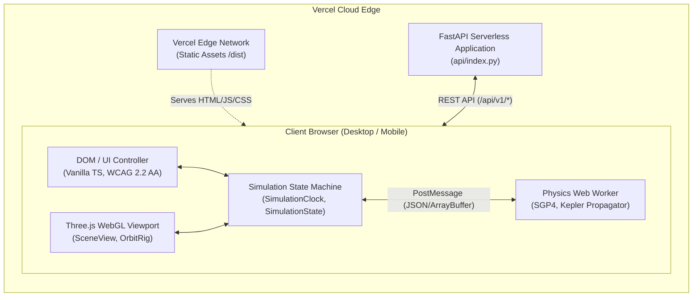
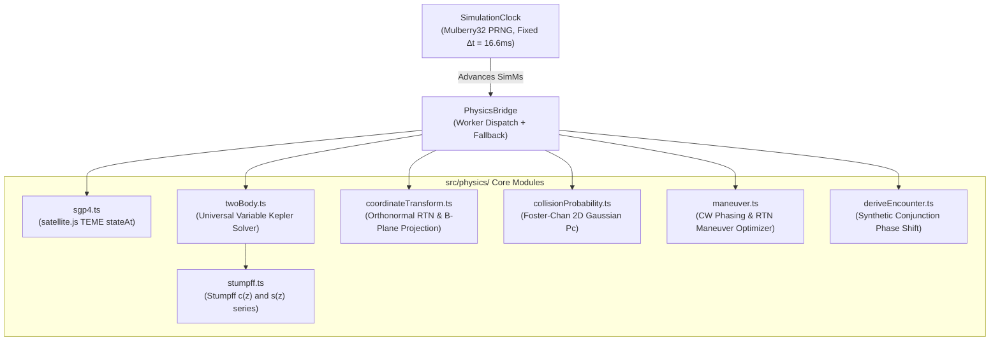
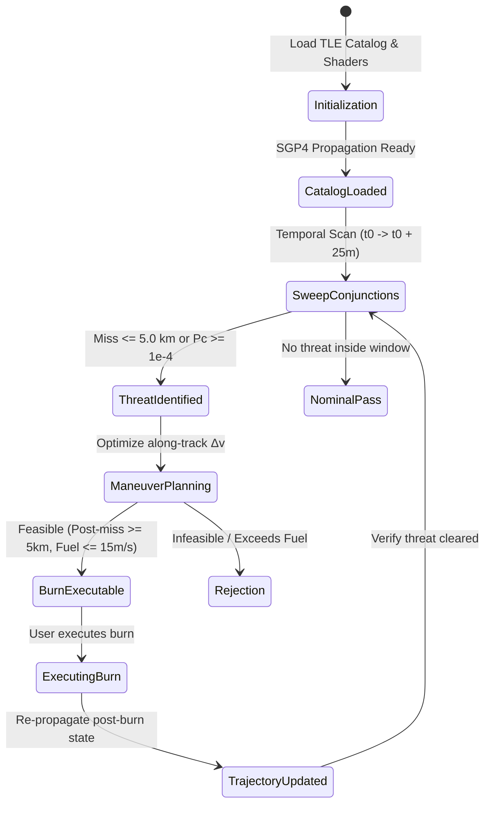

# QuantumOrbit Sim — System Architecture

**System**: QuantumOrbit Orbital Conjunction Assessment Console  
**Standard**: C4 Model (Context, Containers, Components)  
**Target Environment**: WebGL (Three.js) + TypeScript (Vite) + FastAPI (Serverless)

---

## 1. System Context (C4 Level 1)

QuantumOrbit Sim provides proximity operations analysis, conjunction assessment, and impulsive collision avoidance maneuver (CAM) planning for active Earth observation satellites in Low Earth Orbit (LEO).

---

## 2. Container Diagram (C4 Level 2)

---

## 3. Component Diagram: Physics & Simulation Core (C4 Level 3)

---

## 4. Simulation Lifecycle State Machine

---

## 5. Web Worker Concurrency & Memory Safety
1. **Isolation**: High-overhead algorithms (`findApproach` across 400 debris objects, iterative Newton-Raphson Kepler solving) execute off the main rendering thread.
2. **Graceful Fallback**: If browser Web Workers are blocked by CSP or unsupported, `PhysicsBridge` automatically falls back to synchronous main thread execution without crashing.
3. **Data Immutability**: All states passed through the worker bridge are decoupled data transfer objects (DTOs), preventing shared memory race conditions.

---

## 6. Cyber Security & Hardened Boundary Architecture
1. **Security Headers Middleware**: Content Security Policy (strict script/style/connect/img/font/object restrictions), `X-Content-Type-Options: nosniff`, `X-Frame-Options: DENY`, `X-XSS-Protection: 1; mode=block`, `Cross-Origin-Opener-Policy: same-origin`.
2. **Token Bucket Rate Limiting**: `slowapi` protects compute-intensive optimization endpoints (`60/min`) and anonymous telemetry ingestion (`120/min`).
3. **Strict Origin Validation**: Explicit whitelist for local and configured production hosts; wildcard CORS is disabled.
4. **Pydantic v2 Schema Enforcement**: All ingestion contracts strictly enforce `extra="forbid"` to eliminate parameter injection.
5. **SSRF & Memory Amplification Protection**: Upstream CelesTrak proxies enforce strict regex parsing, a 5.0s timeout, and a 2 MB streaming byte cap.

---

## 7. Thermal, Battery & Green Web Architecture
1. **HiDPI Clamping**: Render pixel ratio capped to `1.25x` in standard mode and `1.0x` in Eco mode, avoiding 4× to 9× pixel shading penalties on Retina/4K displays.
2. **Adaptive Framerate & Tab Sleep**:
   - `visibilitychange` handler completely sleeps WebGL rendering and physics loops when the browser tab is hidden.
   - On-demand rendering when paused: skips `renderer.render()` when camera controls have settled.
   - User-selectable Eco mode stepping frame interval to 30 FPS.
3. **Zero-Allocation RAF Loop**: Pre-allocated scratch matrices, vectors, and quaternions prevent GC allocation spikes during continuous 60 FPS animation.
4. **10 Hz DOM Throttling**: Decouples 60 FPS WebGL canvas rendering from DOM layout style calculations.
5. **Instanced Draw Call Budget**: Debris points and velocity vectors are batched via `THREE.Points` and `THREE.InstancedMesh`, keeping total draw calls $\le 20$.
