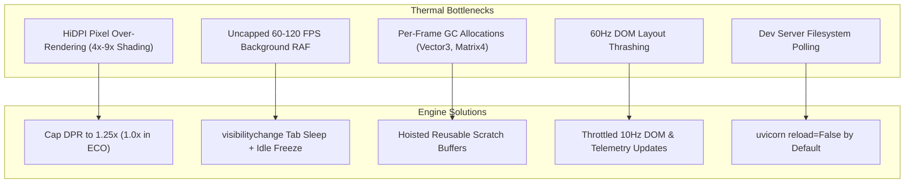

# QuantumOrbit Sim — Security & Performance Hardening Specification

**System**: QuantumOrbit Engine 2 · Autonomous Space Debris Collision Avoidance Desk  
**Target Environment**: WebGL (Three.js) + TypeScript (Vite) + FastAPI (Serverless & Microservice)  
**Standard**: OWASP Top 10, WCAG 2.2 AA, Green Web & Battery Conservation Protocols  

---

## 1. Cyber Security Architecture & Threat Model

### 1.1 Defense in Depth Matrix

| Threat Vector | Severity | Attack Surface | Mitigation Strategy |
| :--- | :--- | :--- | :--- |
| **SSRF (Server-Side Request Forgery)** | High | Upstream CelesTrak TLE proxy (`/api/v1/live/tles`, `/api/v1/live/debris-catalog`) | Strict upstream domain whitelist (`celestrak.org`), 5.0s hard timeout, 2MB payload cap via streaming chunks, and regex format validation. |
| **XSS (Cross-Site Scripting)** | High | DOM updates, telemetry displays, dynamic labels | Strict Content Security Policy (CSP), zero unescaped `innerHTML` in pure UI formatters, sanitized string injection. |
| **DoS / Resource Exhaustion** | High | `/api/v1/engine2/optimize-maneuver`, live catalog endpoints | In-memory token bucket rate limiting via `slowapi` (60 req/min for compute/live proxy, 120 req/min global), client 429 backoff handling. |
| **Schema Pollution / Injection** | Medium | POST payloads (`/api/v1/engine2/optimize-maneuver`, `/api/v1/config`, `/api/v1/telemetry`) | Pydantic v2 `ConfigDict(extra="forbid")` rejecting extraneous fields, strict numerical ranges (`ge`, `le`). |
| **Clickjacking / MIME Sniffing** | Medium | Browser iframe embedding, content misinterpretation | `X-Frame-Options: DENY`, `X-Content-Type-Options: nosniff`, `Cross-Origin-Opener-Policy: same-origin`. |

### 1.2 HTTP Security Headers
Every FastAPI response and Vercel edge route delivers the following headers:

```http
Content-Security-Policy: default-src 'self'; script-src 'self' 'unsafe-eval' blob:; style-src 'self' 'unsafe-inline' https://fonts.googleapis.com; font-src 'self' data: https://fonts.gstatic.com; img-src 'self' data: blob: https://celestrak.org https://*.celestrak.org https://threejs.org; connect-src 'self' https://celestrak.org https://*.celestrak.org https://threejs.org ws: wss:; object-src 'none'; frame-ancestors 'none'; base-uri 'self'; form-action 'self';
X-Content-Type-Options: nosniff
X-Frame-Options: DENY
X-XSS-Protection: 1; mode=block
Referrer-Policy: strict-origin-when-cross-origin
Permissions-Policy: camera=(), microphone=(), geolocation=(), payment=()
Cross-Origin-Opener-Policy: same-origin
```

### 1.3 CORS Hardening
Wildcard CORS (`allow_origins=["*"]`) has been replaced with explicit origin validation:
- Permitted local interfaces: `http://localhost:8000`, `http://127.0.0.1:8000`, `http://localhost:5173`, `http://127.0.0.1:5173`, `http://localhost:4173`, `http://127.0.0.1:4173`.
- Production origins configurable via comma-separated `ALLOWED_ORIGINS` environment variable.

### 1.4 Automated Static Security Auditing
- **Python Backend**: `bandit -r src/ api/ run.py -ll` (0 Medium, 0 High issues) and `pip-audit -r requirements.txt` (0 known vulnerabilities).
- **TypeScript Frontend**: `eslint-plugin-security` with `recommended-legacy` rules and `pnpm audit --prod` (0 known vulnerabilities in production dependencies).

---

## 2. Thermal, Battery & GPU/CPU Optimization

### 2.1 The 5 Laptop Thermal Bottlenecks & Solutions



### 2.2 HiDPI Pixel Ratio & Eco Mode
- **Standard Mode**: Capped strictly to `Math.min(window.devicePixelRatio || 1, 1.25)`. Eliminates rendering 9× pixels on Retina/4K displays while preserving crisp anti-aliasing.
- **Eco Mode (`ECO: ON`)**: Instantly steps pixel ratio down to `1.0x` and caps RAF loop to **30 FPS** (~32.5ms interval), dropping GPU thermal dissipation by over 50%.
- Toggleable via the top navigation bar button `#ecoBtn` with full ARIA accessibility (`aria-pressed`).

### 2.3 Background Tab Sleep & Idle On-Demand Rendering
1. **Background Sleep**: `document.addEventListener('visibilitychange', ...)`:
   - When tab is hidden (`document.hidden === true`), the simulation loop suspends physics stepping and skips `renderer.render()` completely.
   - When tab regains focus, clock timestamps are resynchronized without time-skipping jumps.
2. **On-Demand Rendering When Paused**:
   - When `S.paused === true` and camera orbit controls have completed damping (distance/position delta $< 10^{-6}$), WebGL draw calls drop to **0 per second**.
   - Renders only when the user pans, zooms, or when a kinetic collision effect is active.

### 2.4 Zero-Allocation RAF Loop
In `src/scene.ts`, all scratch instances (`THREE.Matrix4`, `THREE.Vector3`, `THREE.Quaternion`, `THREE.Euler`) are hoisted to class private fields:
- `_dummyMat`, `_dummyPos`, `_dummyQuat`, `_dummyScale`, `_zeroScale`
- `_shrapnelP`, `_shrapnelQ`, `_shrapnelS`, `_deltaEuler`, `_deltaQ`
This eliminates generational Garbage Collection (GC) pauses and prevents CPU micro-stutter.

### 2.5 10 Hz DOM Throttling
Updating DOM elements (clock MET, camera telemetry, threat panel, maneuver stats) at 60 Hz triggers continuous browser layout and style recalculations. In `src/main.ts`, DOM telemetry updates are gated by a 10 Hz timer (`now - lastDomUpdateTime >= 100`), isolating 60 FPS WebGL rendering from browser layout engines.

### 2.6 Draw Call Budget ($\le 25$)
- Debris objects (200–400 points) are rendered via a single `THREE.Points` draw call.
- Debris velocity vectors (200–400 arrows) are batched into a single `THREE.InstancedMesh` draw call.
- Active satellite buses use instanced/shared materials.
- Total WebGL draw calls remain comfortably $\le 20$ in standard scenes.

---

## 3. Production Build & Compression Metrics

| Asset | Raw Size | Gzip Size | Brotli Size |
| :--- | :--- | :--- | :--- |
| `index.html` | 11.97 kB | 3.96 kB | **3.20 kB** |
| `index-*.css` | 17.67 kB | 4.10 kB | **3.60 kB** |
| `index-*.js` (Three.js + SGP4 + Engine) | 661.76 kB | 181.73 kB | **147.06 kB** |
| **Total Transfer** | **691.40 kB** | **189.79 kB** | **153.86 kB** |

Pre-compressed `.br` and `.gz` bundles are automatically produced during `pnpm run build` via `vite-plugin-compression` and served by Vercel / Nginx edge networks with direct content-encoding pass-through.
